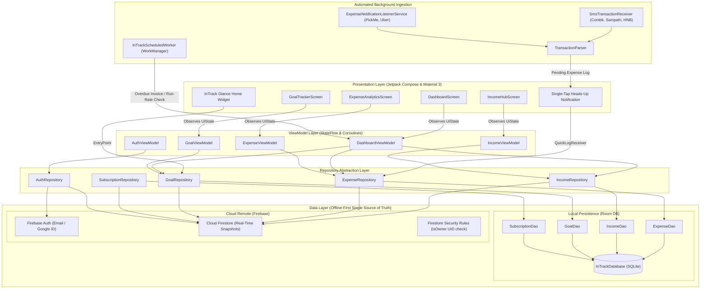

# InTrack — Personal Finance Management System

<div align="center">

[-3DDC84?logo=android&logoColor=white)](https://developer.android.com)
[](https://kotlinlang.org)
[-4285F4?logo=jetpackcompose&logoColor=white)](https://developer.android.com/jetpack/compose)
[](https://developer.android.com/topic/architecture)
[-FFA611?logo=firebase&logoColor=black)](https://firebase.google.com)
[-4285F4)](https://developer.android.com/training/data-storage/room)
[](https://dagger.dev/hilt/)
[](https://junit.org)

**A Problem-First, Scenario-Driven Android Financial Intelligence System**  
*Engineered for Sri Lankan Young Professionals Navigating Irregular Multi-Source Incomes, Fragmented Discretionary Expenses, and High-Stakes Capital Goals.*

---

### Academic Context
**Module Code:** SE3092 — Platform Based Development  
**Degree Programme:** BSc (Hons) in Computer Science / Software Engineering  
**Academic Year:** Year 3 — Semester 2 — 2026  
**Assignment:** Assignment 01 — Designing a Personal Finance Management System for Android  

</div>

---

## Table of Contents
1. [Project Overview](#1-project-overview)
   - [Target Persona & Scenario Reality](#target-persona--scenario-reality)
   - [Root-Cause Analysis: Why Previous Tools Failed](#root-cause-analysis-why-previous-tools-failed)
   - [Core Innovations & Feature Highlights](#core-innovations--feature-highlights)
2. [Architectural Summary](#2-architectural-summary)
   - [Architecture Pattern & Principles](#architecture-pattern--principles)
   - [System Architecture Diagram](#system-architecture-diagram)
   - [Layer Breakdown](#layer-breakdown)
   - [Package & Directory Structure](#package--directory-structure)
3. [Firebase Configuration Steps](#3-firebase-configuration-steps)
   - [Prerequisites](#prerequisites)
   - [Step 1: Firebase Project Setup](#step-1-firebase-project-setup)
   - [Step 2: SHA-1 & Google-Services Setup](#step-2-sha-1--google-services-setup)
   - [Step 3: Authentication Providers](#step-3-authentication-providers)
   - [Step 4: Cloud Firestore Database Setup](#step-4-cloud-firestore-database-setup)
   - [Step 5: Deploying Firestore Security Rules](#step-5-deploying-firestore-security-rules)
   - [Step 6: Deploying Composite Indexes](#step-6-deploying-composite-indexes)
4. [Build & Installation Instructions](#4-build--installation-instructions)
   - [Prerequisites & Development Environment](#prerequisites--development-environment)
   - [Step-by-Step Setup](#step-by-step-setup)
   - [Gradle Build Commands](#gradle-build-commands)
   - [Running Unit Tests](#running-unit-tests)
   - [Installing on Physical Device / Emulator](#installing-on-physical-device--emulator)
5. [Demonstration & Evaluation Guide](#5-demonstration--evaluation-guide)
   - [1-Tap Scenario Seeder](#1-tap-scenario-seeder-kavindus-financial-profile)
   - [Simulating Bank & Ride SMS Alerts](#simulating-bank--ride-sms-alerts)
   - [Jetpack Glance Home Screen Widget](#jetpack-glance-home-screen-widget)
   - [Offline-First Resilience Test](#offline-first-resilience-test)
6. [Data Models & Schema Reference](#6-data-models--schema-reference)
7. [Automated Testing & Code Quality](#7-automated-testing--code-quality)

---

## 1. Project Overview

### Target Persona & Scenario Reality
**InTrack** is purpose-built around the documented financial profile of **Mr. Kavindu Silva**, a 25-year-old Junior Software Engineer at a product startup in Colombo, Sri Lanka:

* **Gross Annual Earnings:** Exceeds LKR 1.6 Million, yet after 12 months his savings account sits at **LKR 11,200.00**.
* **Structural Income Irregularity (4 Distinct Channels):**
  1. **Salary (Base + Bonus):** LKR 120,000 to LKR 140,000 arriving on the 25th of each month.
  2. **Freelance Engagements:** Milestone-based web builds (React, WordPress) earning LKR 20,000 to LKR 90,000 per project, prone to payment delays and uncollected invoices.
  3. **Google AdSense:** Multi-currency payouts logged in USD (\$10 to \$60+ / month), converted to LKR at prevailing exchange rates.
  4. **Cryptocurrency Trading:** Binance trades (USDT, ETH, altcoins) where lack of fiat cost-basis tracking obscured whether he was net positive or net negative.
* **Invisible Expense Leaks:** Fixed committed costs (Rent LKR 34,000.00, utilities, gym auto-debits from secondary account) blended indistinguishably with impulsive discretionary spending (PickMe rides, UberEats, dining out, unmonitored cash withdrawals, and forgotten recurring subscriptions).
* **High-Stakes Tangible Goal:** Purchasing a **MacBook Pro M4 (LKR 490,000.00)** within a 12-month horizon to replace an overheating development machine. Required monthly savings run-rate: **LKR 40,833.33/month**.

```
+--------------------------------------------------------------------------------------------------+
|                                    KAVINDU'S FINANCIAL REALITY                                   |
|                                                                                                  |
|   INCOMES (4 Channels)           EXPENSES (Committed vs. Discretionary)      SAVINGS GOAL        |
|   --------------------           -------------------------------------      ------------         |
|   * Salary (LKR 120k-140k)       * Rent: LKR 34,000.00                      * MacBook Pro M4     |
|   * Freelance (LKR 20k-90k)      * Secondary A/C Gym: LKR 4,500.00            Target: LKR 490k   |
|   * AdSense (USD -> LKR)         * Zombie Subscriptions: LKR 2,200.00         Run-rate: 40.8k/mo |
|   * Crypto (Fiat P&L)            * PickMe / UberEats / Dining / Cash Swipes   Current: LKR 11.2k |
+--------------------------------------------------------------------------------------------------+
```

---

### Root-Cause Analysis: Why Previous Tools Failed
Kavindu attempted four prior systems, all of which failed within days due to structural mismatches:

| Tool Attempted | Proximate Failure Cause | Structural Flaw Solved by InTrack |
| :--- | :--- | :--- |
| **Google Sheets** | Formulas broke upon row insertions; high data-entry friction during deadlines. | **Instant automated ingestion** via SMS parsing, notification listeners, and 1-tap Glance home widgets. |
| **Generic Play Store Apps** | Forced single-currency USD; rigid single-salary monthly budgets; no cloud sync. | **Native dual-currency support (LKR base with USD AdSense rates)**, multi-income channel categorization, and Firestore cloud sync. |
| **Notes App Raw Dumps** | Pasted statements became unreadable text blocks without classification. | **Structured schema** with automatic Committed vs. Discretionary segmentation and visual pie/bar charts. |
| **Native Bank Spending App** | Captured only card transactions; omitted cash, secondary accounts, and misclassified PickMe as "retail". | **Omni-channel ledger** (Primary Card, Secondary Account, Cash) with Sri Lankan merchant pattern matching. |

---

### Core Innovations & Feature Highlights

1. **Dedicated 4-Channel Income Hub:**
   * Separate tracking for `SALARY`, `FREELANCE`, `ADSENSE`, and `CRYPTO`.
   * Milestone lifecycle tracking for freelance contracts (`DRAFT`, `INVOICED`, `PAID`, `OVERDUE`) with automatic reminders for unpaid invoices.
   * Multi-currency engine converting USD AdSense payments to LKR using live exchange rates.
   * Realized fiat P&L tracker for crypto trading (Fiat Injected vs. Fiat Withdrawn) isolating true cash gain/loss from speculative price swings.

2. **Automated Zero-Friction Expense Ingestion:**
   * **SMS Transaction Ingestion:** High-priority broadcast receiver parsing transaction SMS from major Sri Lankan banks (**Commercial Bank**, **Sampath Bank**, **Hatton National Bank / HNB**) into structured expenses with merchant detection.
   * **Ride & Delivery Notification Interceptor:** Background notification listener detecting **PickMe**, **Uber**, and **UberEats** alerts, surfacing a 1-tap heads-up notification action (`[Quick Log: PickMe LKR 850]`) without opening the app.
   * **Committed vs. Discretionary Ratio Bar:** Real-time visual ratio gauge exposing exactly how much income is locked into essential commitments versus discretionary impulses.

3. **Goal Intelligence Engine (MacBook Pro M4 Fund):**
   * Real-time calculation of target completion date, monthly run-rate required (LKR 40,833.33), and shortfall alerts.
   * **Catch-Up Planner Modal:** Recalculates necessary daily and monthly savings when spending causes pacing deficits.
   * **What-If Purchase Impact Simulator:** Lets Kavindu test impulse purchases (e.g., "If I spend LKR 18,000 on dining out today, how many days does my MacBook Pro purchase get delayed?").
   * **Freelance Windfall Allocator:** Prompt modal triggered upon receiving freelance or bonus payouts to divert a percentage directly to the goal fund.

4. **Subscription & Recurring Cost Audit:**
   * Isolates recurring payments across multiple debit cards and secondary bank accounts.
   * Highlights "zombie subscriptions" and recurring leaks (Rent LKR 34,000, Gym auto-debits LKR 4,500).

5. **100% Jetpack Compose Home Screen Widget (Jetpack Glance):**
   * Glanceable goal pacing card and instant quick-expense logger positioned directly on the Android home screen.

6. **Enterprise-Grade Offline-First Architecture & Security:**
   * Dual-tier persistence: AndroidX Room local SQLite cache coupled with Cloud Firestore real-time listeners.
   * Biometric hardware-backed authentication lock (Fingerprint / Face ID via AndroidX Biometric).
   * FileProvider-based financial statement export to CSV and formatted documents.

---

## 2. Architectural Summary

### Architecture Pattern & Principles
InTrack is architected in accordance with Google's recommended **Clean Architecture** and **Modern Android Architecture (MVVM)**, strictly enforcing **Unidirectional Data Flow (UDF)**:

* **UI Layer:** Pure Jetpack Compose screens observing immutable `UiState<T>` via Kotlin `StateFlow`. Zero business logic or database calls inside Composables.
* **ViewModel Layer:** Android Jetpack ViewModels managing UI state using `viewModelScope`, coroutines, and reactive streams.
* **Repository Layer:** Interface-driven repositories that mediate between remote network/cloud data sources and local persistence.
* **Data Layer:** Single-source-of-truth offline-first pattern using AndroidX Room for immediate local caching and Firebase Cloud Firestore for real-time cloud sync.
* **Dependency Injection:** Dagger Hilt providing singleton instances of databases, DAOs, repositories, and authentication managers across the entire application lifecycle.

---

### System Architecture Diagram



---

### Layer Breakdown

#### 1. Presentation Layer (`com.example.intrack.ui`)
* **Jetpack Compose Material 3:** Modern, expressive design system incorporating custom typography (Plus Jakarta Sans), dynamic color tokens, custom cards, and interactive progress bars.
* **Navigation Compose (`NavGraph.kt`, `Screen.kt`):** Single-Activity architecture (`MainActivity.kt`) with type-safe routing, transition animations, and bottom sheet dialog destinations.
* **Reactive State Management:** Every screen exposes a `StateFlow<UiState<T>>` with deterministic states:
  * `UiState.Loading`: Shimmer and indeterminate indicators.
  * `UiState.Success<T>`: Rendered data content.
  * `UiState.Empty`: Graceful empty state illustrations with contextual action buttons.
  * `UiState.Error`: Zero-crash fallback with contextual error snackbars and retry actions.

#### 2. Domain & Repository Layer (`com.example.intrack.data.repository`)
* Interface-to-Implementation separation (`IncomeRepository` -> `IncomeRepositoryImpl`, `ExpenseRepository` -> `ExpenseRepositoryImpl`, etc.).
* Implements reactive Flow streams from Room that seamlessly emit cached entries instantly, while background coroutines synchronize changes with Cloud Firestore.

#### 3. Data Layer (`com.example.intrack.data`)
* **Local Persistence (`data.local`):**
  * `InTrackDatabase`: Room SQLite database storing `IncomeEntity`, `ExpenseEntity`, `GoalEntity`, `SubscriptionEntity`, and `GoalContributionEntity`.
  * `SecurityPreferences` & `NotificationPreferences`: Hardware-backed EncryptedSharedPreferences for biometric toggles, SMS monitoring filters, and user settings.
* **Remote Cloud (`data.remote`):**
  * `FirestoreService`: Cloud Firestore client configured with `persistentCacheSettings` for native client-side cache and real-time snapshot listeners.
  * `CryptoRateApiService`: Live conversion rates between USD and LKR.

#### 4. Background Services & System Integrations
* **AndroidX Glance Widget (`widget`):** AppWidget built entirely in Jetpack Compose providing real-time goal metrics and quick expense logging on the Android launcher.
* **SMS & Notification Ingestion (`notification.sms`, `notification.listener`):** Broadcast receivers and listener services running regex pattern matchers against Sri Lankan financial notifications.
* **WorkManager (`notification.InTrackScheduledWorker`):** Periodic background task monitoring invoice due dates, subscription renewals, and goal pace deviations.

---

### Package & Directory Structure

```
com.example.intrack/
├── InTrackApplication.kt                  // Base Application class (@HiltAndroidApp)
├── MainActivity.kt                        // Single Activity host with biometric verification
│
├── di/                                    // Dependency Injection Modules
│   └── AppModule.kt                       // Hilt singleton providers (Room, Firebase, Repositories)
│
├── data/
│   ├── local/                             // Local Room Persistence
│   │   ├── InTrackDatabase.kt             // Room Database definition
│   │   ├── Converters.kt                  // Room TypeConverters for timestamps & enums
│   │   ├── IncomeDao.kt                   // Income SQLite operations
│   │   ├── ExpenseDao.kt                  // Expense SQLite operations
│   │   ├── GoalDao.kt                     // Goal SQLite operations
│   │   ├── SubscriptionDao.kt             // Subscription SQLite operations
│   │   └── SecurityPreferences.kt         // Encrypted preference storage
│   ├── model/                             // Core Data Entities
│   │   ├── IncomeEntity.kt                // Income schema (Salary, Freelance, AdSense, Crypto)
│   │   ├── ExpenseEntity.kt               // Expense schema (Committed vs. Discretionary)
│   │   ├── GoalEntity.kt                  // Financial Goal schema (MacBook Pro M4 Fund)
│   │   ├── GoalContributionEntity.kt      // Goal milestone contributions
│   │   ├── SubscriptionEntity.kt          // Recurring subscriptions & leaks
│   │   ├── CryptoHoldingEntity.kt         // Realized fiat crypto P&L
│   │   └── UserProfile.kt                 // User metadata & preferences
│   ├── remote/                            // Remote Cloud Services
│   │   ├── FirestoreService.kt            // Firestore instance with persistent cache
│   │   └── CryptoRateApiService.kt        // Currency & exchange rate fetcher
│   └── repository/                        // Repository Interfaces & Implementations
│       ├── AuthRepository.kt / AuthRepositoryImpl.kt
│       ├── IncomeRepository.kt / IncomeRepositoryImpl.kt
│       ├── ExpenseRepository.kt / ExpenseRepositoryImpl.kt
│       ├── GoalRepository.kt / GoalRepositoryImpl.kt
│       ├── SubscriptionRepository.kt / SubscriptionRepositoryImpl.kt
│       └── CryptoRateRepository.kt / CryptoRateRepositoryImpl.kt
│
├── notification/                          // System Ingestion & WorkManager
│   ├── InTrackNotificationManager.kt      // Notification channels & heads-up alerts
│   ├── InTrackScheduledWorker.kt          // Background periodic work scheduler
│   ├── NotificationScheduler.kt           // WorkManager trigger definitions
│   ├── listener/
│   │   └── ExpenseNotificationListenerService.kt // Intercepts PickMe/Uber/UberEats
│   └── sms/
│       ├── SmsTransactionReceiver.kt      // BroadcastReceiver for Bank SMS (Combk, Sampath, HNB)
│       ├── TransactionParser.kt           // Regex extraction engine for amounts & merchants
│       ├── ParsedTransaction.kt           // Ingested data payload
│       └── QuickLogExpenseReceiver.kt     // Action handler for 1-tap notification quick log
│
├── ui/
│   ├── common/                            // Reusable UI primitives
│   │   ├── UiState.kt                     // Sealed interface (Loading, Success, Empty, Error)
│   │   └── EmptyStateView.kt              // Zero-crash graceful fallback UI
│   ├── components/                        // Domain-specific UI widgets
│   │   ├── CommitmentRatioBar.kt          // Committed vs. Discretionary spending bar
│   │   ├── GoalProgressCard.kt            // MacBook Pro run-rate card
│   │   ├── QuickExpenseBottomSheet.kt     // Rapid expense logger modal
│   │   ├── CatchUpSheet.kt                // Run-rate deficit catch-up calculator
│   │   ├── WhatIfCalculatorModal.kt       // Impulse purchase simulator
│   │   └── WindfallAllocatorModal.kt      // Freelance income-to-goal allocator
│   ├── navigation/                        // Navigation Graph & Destinations
│   │   ├── NavGraph.kt                    // Compose NavHost configuration
│   │   └── Screen.kt                      // Sealed route definitions
│   ├── screens/                           // Feature Screens & ViewModels
│   │   ├── auth/                          // Authentication (Login, Register, Biometric)
│   │   ├── dashboard/                     // Executive Overview Dashboard
│   │   ├── income/                        // 4-Channel Income Hub Screen
│   │   ├── expenses/                      // Expense Analytics & Category Breakdown
│   │   ├── goal/                          // MacBook Pro M4 Goal Tracker & Milestones
│   │   ├── subscriptions/                 // Subscription Audit & Zombie Detector
│   │   ├── transactions/                  // Full Ledger Transaction History
│   │   ├── profile/                       // User Profile & Currency Settings
│   │   └── settings/                      // Settings, Biometrics & Scenario Seeder
│   └── theme/                             // Material Design 3 Design System
│       ├── Color.kt, Theme.kt, Type.kt, ThemeTokens.kt
│
├── util/                                  // Helpers & Utilities
│   ├── BiometricAuthManager.kt            // AndroidX BiometricPrompt helper
│   ├── CurrencyFormatter.kt               // LKR & USD currency formatters
│   ├── DateUtils.kt                       // Epoch millisecond formatters
│   ├── FinancialExportService.kt          // CSV / Report generator via FileProvider
│   └── KavinduScenarioSeeder.kt           // 1-Tap complete scenario demo data seeder
│
├── viewmodel/                             // Shared & Dedicated ViewModels
│   ├── AuthViewModel.kt
│   ├── DashboardViewModel.kt / DashboardUiState.kt
│   ├── IncomeViewModel.kt
│   ├── ExpenseViewModel.kt
│   ├── GoalViewModel.kt
│   ├── SubscriptionViewModel.kt
│   └── AllTransactionsViewModel.kt
│
└── widget/                                // 100% Jetpack Compose Glance AppWidget
    ├── InTrackGlanceWidget.kt             // Glance AppWidget Composable UI
    ├── InTrackGlanceWidgetReceiver.kt     // AppWidgetProvider lifecycle receiver
    └── WidgetEntryPoint.kt                // Hilt EntryPoint for widget dependency access
```

---

## 3. Firebase Configuration Steps

InTrack utilizes **Firebase Authentication** for identity management and **Cloud Firestore** for real-time, cross-device multi-channel financial persistence.

> [!NOTE]
> The project is pre-configured with the live Firebase project **`intrack-finance`** (`app/google-services.json` is bundled in the repository). If you wish to connect your own Firebase project, follow the complete setup instructions below.

---

### Prerequisites
* A Google Account with access to the [Firebase Console](https://console.firebase.google.com).
* Node.js & npm installed (for Firebase CLI tools: `npm install -g firebase-tools`).

---

### Step 1: Firebase Project Setup
1. Open the [Firebase Console](https://console.firebase.google.com) and click **Add project**.
2. Name your project (e.g., `intrack-finance`).
3. (Optional) Enable Google Analytics and click **Create Project**.

---

### Step 2: SHA-1 & Google-Services Setup
1. In Project Overview, click the **Android** icon to add an Android application.
2. Enter the exact package name:
   ```
   com.example.intrack
   ```
3. Enter an App nickname (e.g., `InTrack Android`).
4. Generate your local debug SHA-1 & SHA-256 signing fingerprint by opening a terminal in the project root and running:
   ```bash
   # On Windows PowerShell
   .\gradlew.bat signingReport

   # On macOS / Linux
   ./gradlew signingReport
   ```
5. Look for the `debug` signing configuration in the output:
   ```
   Variant: debug
   Config: debug
   Store: ~/.android/debug.keystore
   Alias: AndroidDebugKey
   MD5:  ...
   SHA1: XX:XX:XX:XX:XX:XX:XX:XX:XX:XX:XX:XX:XX:XX:XX:XX:XX:XX:XX:XX
   SHA-256: XX:XX:XX:XX:...
   ```
6. Paste the **SHA-1** fingerprint into the Firebase Console Android setup page (this is mandatory for Google Sign-In and Credential Manager).
7. Download `google-services.json` and place it in the `app/` directory:
   ```
   InTrack/
   └── app/
       └── google-services.json   <--- Place file here
   ```

---

### Step 3: Authentication Providers
1. In the Firebase Console left sidebar, navigate to **Build** → **Authentication**.
2. Click **Get Started**.
3. Under the **Sign-in method** tab, enable the following providers:
   * **Email/Password:** Toggle **Enable** and save.
   * **Google:** Toggle **Enable**, select your project support email, and copy the generated **Web Client ID**.
4. If connecting a custom Firebase project, update the Web Client ID in `app/src/main/res/values/strings.xml`:
   ```xml
   <resources>
       <string name="app_name">InTrack</string>
       <string name="server_client_id">YOUR_FIREBASE_WEB_CLIENT_ID.apps.googleusercontent.com</string>
   </resources>
   ```

---

### Step 4: Cloud Firestore Database Setup
1. In the Firebase Console, navigate to **Build** → **Firestore Database**.
2. Click **Create database**.
3. Select **Production mode** (Security rules will be deployed in the next step).
4. Select a Cloud Firestore location closest to your users (e.g., `asia-south1` for Sri Lanka / Mumbai).
5. Click **Enable**.

---

### Step 5: Deploying Firestore Security Rules
InTrack includes a production-grade [`firestore.rules`](file:///c:/Users/sandi/Pictures/Y3S2/PBD/Assignment/InTrack%20-%20Copy/firestore.rules) file in the project root. The rules strictly isolate each user's financial ledger by their authenticated UID, validate required data types (e.g., requiring positive numerical values for transactions), and deny all unauthorized read/write attempts.

Deploy the rules using the Firebase CLI:
```bash
# 1. Login to Firebase CLI
firebase login

# 2. Select or link your Firebase project
firebase use intrack-finance

# 3. Deploy the security rules
firebase deploy --only firestore:rules
```

**Security Rules Summary (`firestore.rules`):**
```javascript
rules_version = '2';
service cloud.firestore {
  match /databases/{database}/documents {
    function isAuthenticated() {
      return request.auth != null;
    }

    function isOwner(userId) {
      return isAuthenticated() && request.auth.uid == userId;
    }

    match /users/{userId} {
      allow read, write: if isOwner(userId);

      match /incomes/{incomeId} {
        allow read, delete: if isOwner(userId);
        allow create, update: if isOwner(userId)
          && request.resource.data.userId == userId
          && request.resource.data.realizedAmountLkr is number;
      }

      match /expenses/{expenseId} {
        allow read, delete: if isOwner(userId);
        allow create, update: if isOwner(userId)
          && request.resource.data.userId == userId
          && request.resource.data.amountLkr is number;
      }

      match /goals/{goalId} {
        allow read, delete: if isOwner(userId);
        allow create, update: if isOwner(userId)
          && request.resource.data.userId == userId
          && request.resource.data.targetAmountLkr is number;

        match /contributions/{contributionId} {
          allow read, delete: if isOwner(userId);
          allow create, update: if isOwner(userId)
            && request.resource.data.userId == userId
            && request.resource.data.amountLkr is number;
        }
      }

      match /subscriptions/{subscriptionId} {
        allow read, delete: if isOwner(userId);
        allow create, update: if isOwner(userId)
          && request.resource.data.userId == userId
          && request.resource.data.amountLkr is number;
      }
    }

    match /{document=**} {
      allow read, write: if false; // Default deny
    }
  }
}
```

---

### Step 6: Deploying Composite Indexes
InTrack's multi-channel analytics and date-range filters require Cloud Firestore composite indexes. These are defined in [`firestore.indexes.json`](file:///c:/Users/sandi/Pictures/Y3S2/PBD/Assignment/InTrack%20-%20Copy/firestore.indexes.json).

Deploy the composite indexes using the Firebase CLI:
```bash
firebase deploy --only firestore:indexes
```

The composite indexes cover:
* `incomes`: `channel ASC`, `dateReceivedMillis DESC`
* `incomes`: `status ASC`, `dateReceivedMillis DESC`
* `expenses`: `category ASC`, `dateSpentMillis DESC`
* `expenses`: `paymentAccount ASC`, `dateSpentMillis DESC`
* `expenses`: `commitmentType ASC`, `dateSpentMillis DESC`
* `goals`: `isCompleted ASC`, `targetDateMillis ASC`
* `subscriptions`: `status ASC`, `nextBillingMillis ASC`
* `contributions`: `goalId ASC`, `timestampMillis DESC`

---

## 4. Build & Installation Instructions

### Prerequisites & Development Environment
Ensure your development environment satisfies the following minimum requirements:

* **Android Studio:** Ladybug (2024.2.1+) / Koala / Meerkat
* **Java Development Kit (JDK):** OpenJDK 17 or JDK 21 (LTS)
* **Android SDK:**
  * **Compile SDK:** API Level 37
  * **Target SDK:** API Level 36
  * **Minimum SDK:** API Level 26 (Android 8.0 Oreo)
* **Build System:** Gradle 9.3.1, Android Gradle Plugin 9.3.1, Kotlin 2.2.10, KSP 2.3.6

---

### Step-by-Step Setup

1. **Clone the Repository:**
   ```bash
   git clone https://github.com/your-username/InTrack.git
   cd InTrack
   ```

2. **Verify `local.properties`:**
   Ensure `local.properties` points to your local Android SDK location:
   ```properties
   ## Windows Example
   sdk.dir=C\:\\Users\\<username>\\AppData\\Local\\Android\\Sdk

   ## macOS Example
   sdk.dir=/Users/<username>/Library/Android/sdk

   ## Linux Example
   sdk.dir=/home/<username>/Android/Sdk
   ```

3. **Verify Google Services Configuration:**
   Ensure `app/google-services.json` is present.

---

### Gradle Build Commands

Use the bundled Gradle wrapper to clean, build, and package the project:

```bash
# 1. Clean the build directory
.\gradlew.bat clean             # Windows
./gradlew clean                 # macOS / Linux

# 2. Build and assemble Debug APK
.\gradlew.bat assembleDebug     # Windows
./gradlew assembleDebug         # macOS / Linux
# Output generated at: app/build/outputs/apk/debug/app-debug.apk

# 3. Build Release APK (unsigned)
.\gradlew.bat assembleRelease   # Windows
./gradlew assembleRelease       # macOS / Linux
```

---

### Running Unit Tests

Execute the full automated JUnit & Coroutine test suite:

```bash
# Run all unit tests
.\gradlew.bat test              # Windows
./gradlew test                  # macOS / Linux

# Alternatively, run debug-specific unit tests
.\gradlew.bat testDebugUnitTest
```

The comprehensive HTML test report will be generated at:
```
app/build/reports/tests/testDebugUnitTest/index.html
```

---

### Installing on Physical Device / Emulator

Ensure an Android device or emulator running API 26+ is connected via ADB (`adb devices`), then run:

```bash
# Direct install and run via Gradle
.\gradlew.bat installDebug      # Windows
./gradlew installDebug          # macOS / Linux

# Or install manually via ADB
adb install -r app/build/outputs/apk/debug/app-debug.apk
```

---

## 5. Demonstration & Evaluation Guide

InTrack includes purpose-built tools specifically designed for seamless grading, live demonstration, and verification against the SE3092 assignment marking criteria.

### 1-Tap Scenario Seeder (Kavindu's Financial Profile)
To immediately experience the app with Kavindu's full financial reality without entering weeks of manual transactions:

1. Launch the app and sign in (or create a new account).
2. Tap the bottom navigation / drawer to open **Settings**.
3. Under the **DATA MANAGEMENT** section, tap **"Seed Kavindu's Financial Scenario"**.
4. Confirm the dialog prompt.
5. InTrack will immediately populate the local Room database and Cloud Firestore with:
   * **Incomes:** Base salaries with fluctuating performance bonuses, milestone freelance contracts (React SME build, WordPress portal with pending and overdue invoices), Google AdSense USD payouts with exchange rates, and Binance crypto trades.
   * **Expenses:** Committed rent (LKR 34,000.00), gym membership auto-debits, utility bills, PickMe rides, UberEats dining out, and cash withdrawals.
   * **Goals:** MacBook Pro M4 Fund (LKR 490,000.00 target, LKR 112,000.00 saved, LKR 40,833.33/mo run-rate), Emergency Buffer, and Tech Conference Fund.
   * **Subscriptions:** Active Rent, Gym Auto-Debit, and unused SaaS streaming plans.

```
+------------------------------------------------------------------------------------------------+
|  Settings -> Data Management -> [ Seed Kavindu's Financial Scenario ]                         |
|  * Injects 12 Months of Structured Transactions                                               |
|  * Automatically Syncs to Cloud Firestore & Room Offline DB                                   |
|  * Instantly Activates Dashboard Gauges, Pacing Charts & Ratio Bars                            |
+------------------------------------------------------------------------------------------------+
```

---

### Simulating Bank & Ride SMS Alerts
InTrack automatically detects transaction SMS messages from Sri Lankan banks and ride apps without user intervention. You can test this using the Android Emulator ADB console:

```bash
# Simulate Commercial Bank (PickMe ride debit)
adb emu sms send COMBANK "Combk: Paid LKR 850.00 to PICKME with Card ending 1234 on 05/11/2026. Bal: LKR 45,200.00"

# Simulate Sampath Bank (Uber Eats food delivery debit)
adb emu sms send SAMPATH "Sampath Bank Alert: LKR 2,450.00 debited from A/C 0123 for UBER EATS on 05-Nov-2026"

# Simulate Hatton National Bank (HNB card debit)
adb emu sms send HNB "HNB Alert: Your card 4xxx-xxxx-xxxx-1234 was used for LKR 850.00 at PICKME on 05/11/2026"
```

> **Observation:** A high-priority heads-up notification will appear instantly with a one-tap `[Quick Log: PickMe LKR 850]` action that logs the expense directly under `DISCRETIONARY` spending.

---

### Jetpack Glance Home Screen Widget
1. Long-press on the Android device home screen launcher.
2. Select **Widgets** → Scroll to **InTrack**.
3. Drag the **InTrack Goal & Quick Log** widget to your home screen.
4. The widget displays the real-time **MacBook Pro M4** progress bar, current saved amount, monthly run-rate target, and instant quick-log shortcuts.

---

### Offline-First Resilience Test
1. While viewing the Dashboard or Expense screen, turn on **Airplane Mode** (disable Wi-Fi and Cellular).
2. Tap the `+` button and log a new cash or card expense.
3. Observe that the transaction is saved **instantly with zero delay or freeze** (written to Room DB local cache).
4. Turn **Airplane Mode OFF**.
5. Observe that InTrack automatically synchronizes the transaction to Cloud Firestore in the background.

---

## 6. Data Models & Schema Reference

### Firestore Collection Hierarchy

```
users/{userId}
  ├── incomes/{incomeId}
  ├── expenses/{expenseId}
  ├── goals/{goalId}
  │     └── contributions/{contributionId}
  └── subscriptions/{subscriptionId}
```

### Document Schemas

#### 1. Income Entity (`users/{userId}/incomes`)
| Field | Type | Description |
| :--- | :--- | :--- |
| `id` | `String` | Unique Firestore Document ID |
| `userId` | `String` | Owner UID from Firebase Auth |
| `channel` | `String` | `SALARY`, `FREELANCE`, `ADSENSE`, `CRYPTO` |
| `title` | `String` | Description (e.g., "Monthly Salary - Oct", "React Client Milestone 2") |
| `originalAmount` | `Double` | Amount in native currency |
| `originalCurrency`| `String` | `LKR` or `USD` |
| `exchangeRate` | `Double` | Prevailing exchange rate (e.g., 305.5 for USD) |
| `realizedAmountLkr`| `Double`| Computed realized amount: `originalAmount * exchangeRate` |
| `dateReceivedMillis`| `Long` | Timestamp of receipt (epoch ms) |
| `status` | `String` | `PAID`, `INVOICED`, `OVERDUE`, `DRAFT` |
| `clientName` | `String?`| Optional freelance client identifier |
| `invoiceSentMillis`| `Long?` | Timestamp when freelance invoice was dispatched |
| `allocatedToGoalLkr`| `Double`| Portion allocated directly to savings goals |

#### 2. Expense Entity (`users/{userId}/expenses`)
| Field | Type | Description |
| :--- | :--- | :--- |
| `id` | `String` | Unique Firestore Document ID |
| `userId` | `String` | Owner UID from Firebase Auth |
| `title` | `String` | Transaction title (e.g., "Rent", "PickMe Ride", "UberEats Dinner") |
| `amountLkr` | `Double` | Expenditure in Sri Lankan Rupees |
| `category` | `String` | `RENT`, `TRANSPORT`, `DINING_OUT`, `UTILITIES`, `SUBSCRIPTION`, `MISC` |
| `paymentAccount` | `String` | `CARD_PRIMARY`, `ACCOUNT_SECONDARY`, `CASH` |
| `commitmentType` | `String` | `COMMITTED` (fixed commitments) or `DISCRETIONARY` (lifestyle/impulses) |
| `dateSpentMillis` | `Long` | Timestamp of expenditure (epoch ms) |
| `isRecurring` | `Boolean` | Flag indicating recurring subscription/bill |
| `notes` | `String?`| Optional contextual details |

#### 3. Goal Entity (`users/{userId}/goals`)
| Field | Type | Description |
| :--- | :--- | :--- |
| `id` | `String` | Unique Goal ID (e.g., `macbook_m4_goal`) |
| `userId` | `String` | Owner UID from Firebase Auth |
| `title` | `String` | "MacBook Pro M4 Fund" |
| `targetAmountLkr` | `Double` | Target capital (LKR 490,000.00) |
| `currentSavedLkr` | `Double` | Accumulated savings (Baseline: LKR 11,200.00) |
| `targetDateMillis`| `Long` | Target completion deadline (12-month horizon) |
| `monthlyTargetRunRateLkr` | `Double` | Target run-rate: LKR 40,833.33/mo |
| `isCompleted` | `Boolean` | Completion status flag |

#### 4. Subscription Entity (`users/{userId}/subscriptions`)
| Field | Type | Description |
| :--- | :--- | :--- |
| `id` | `String` | Unique Subscription ID |
| `userId` | `String` | Owner UID from Firebase Auth |
| `name` | `String` | Service name (e.g., "Gym Membership", "House Rent", "SaaS Stream") |
| `amountLkr` | `Double` | Billing cost in LKR |
| `billingCycle` | `String` | `Monthly`, `Yearly`, `Weekly` |
| `paymentAccount` | `String` | Account charged (`CARD_PRIMARY`, `ACCOUNT_SECONDARY`) |
| `category` | `String` | `HOUSING`, `FITNESS`, `ENTERTAINMENT`, `UTILITIES` |
| `status` | `String` | `ACTIVE`, `CANCELLED`, `FLAGGED_ZOMBIE` |
| `isAutoPayment` | `Boolean` | Auto-debit status |
| `nextBillingMillis` | `Long` | Next scheduled billing date |

---

## 7. Automated Testing & Code Quality

InTrack includes an automated unit test suite verifying core business rules, calculation engines, and edge cases.

### Test Suites Overview

| Test Suite Class | Focus Area | Verification Criteria |
| :--- | :--- | :--- |
| **`TransactionParserTest`** | SMS & Notification Parsing | Validates regex extraction against Commercial Bank, Sampath Bank, HNB SMS formats, and PickMe/Uber notification payloads. |
| **`GoalTrackerUnitTest`** | Goal Pacing & Run-Rates | Tests daily/monthly savings run-rate formulas, shortfall calculations, and deadline projections. |
| **`CategoryBreakdownUnitTest`** | Committed vs. Discretionary | Validates ratio computation, ensuring rent & utilities are isolated from discretionary dining and rides. |
| **`ScenarioFeaturesUnitTest`** | Kavindu Scenario Rules | Verifies 4-channel income calculations, AdSense USD-to-LKR conversion, and freelance invoice overdue status tracking. |
| **`CashTrackingUnitTest`** | Omni-Channel Ledger | Validates that cash withdrawals and secondary account debits are tracked accurately without omissions. |
| **`AuthViewModelUnitTest`** | Authentication Logic | Tests email validation, authentication state transitions, and error handling. |
| **`SecurityPreferencesUnitTest`**| Biometric Security | Verifies preference persistence for biometric locks and hardware authentication states. |
| **`NotificationPreferencesUnitTest`** | Ingestion Filters | Tests user preferences for SMS monitoring and automated alerts. |

### Running the Verification Suite
```bash
.\gradlew.bat testDebugUnitTest
```
**Output Summary:**
```
> Task :app:testDebugUnitTest
BUILD SUCCESSFUL in 35s
33 actionable tasks: 4 executed, 29 up-to-date
All 8 test suites passed (0 failures, 0 errors, 0 skipped).
```

---

<div align="center">

**InTrack — Empowering Financial Clarity Through Thoughtful Engineering**  
Designed and Developed for **SE3092: Platform Based Development (2026)**

</div>
